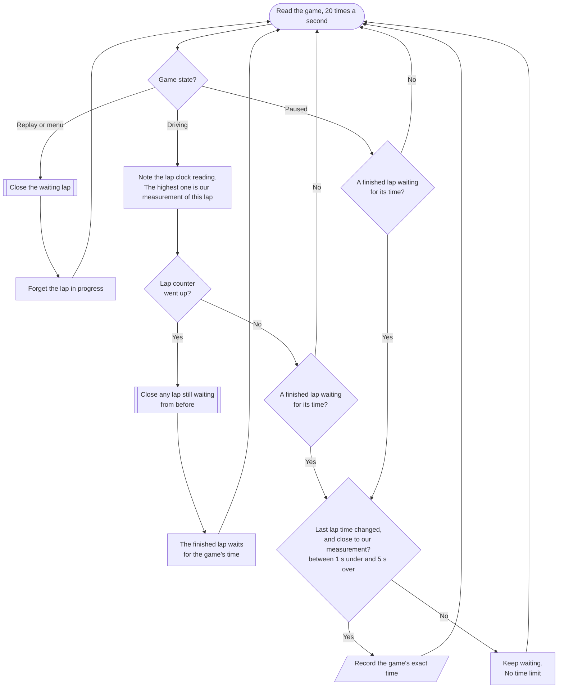
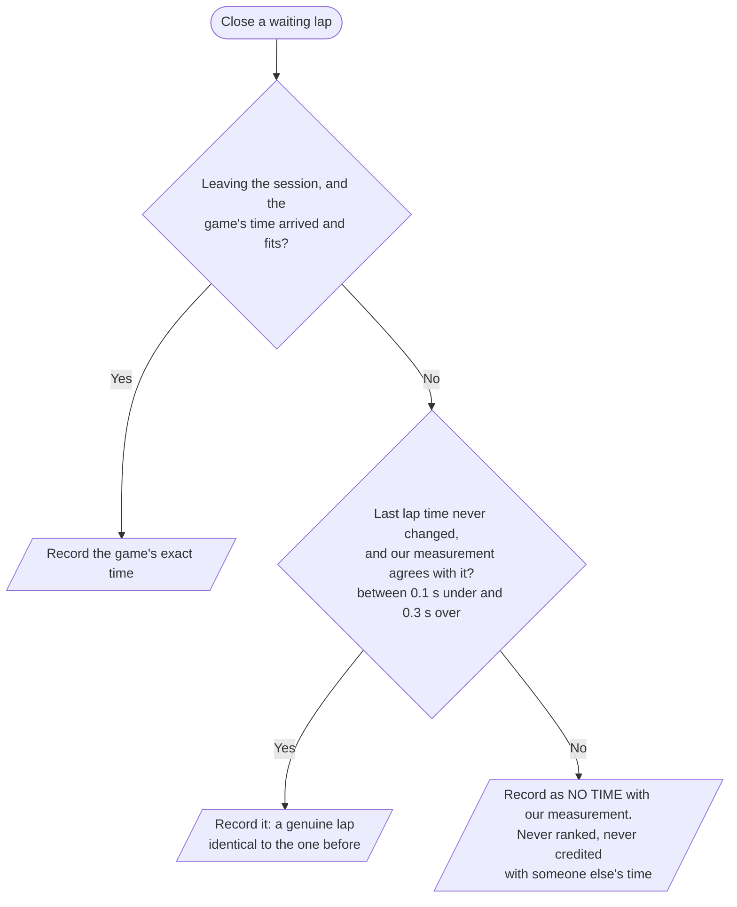
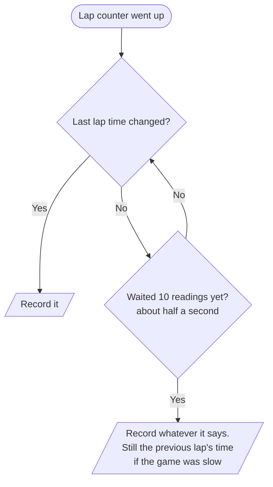

# How lap times are recorded (circuit games)

Assetto Corsa and Assetto Corsa EVO both go through the shared lap tracker
(`crates/tt-games/src/tracker.rs`). Rally stages work differently (see `crates/tt-games/src/stage.rs`):
their time is the stage clock where the game stops it at the finish, so nothing below applies to them.

## What the game gives us

Bin It reads the game's shared memory 20 times a second. Lap timing uses:

| Value | What it is |
|---|---|
| Lap counter | Goes up by one when a lap is completed |
| Last lap time | The game's official time for the last completed lap, exact to the millisecond |
| Lap clock | The running time of the lap in progress |
| Progress | How far round the lap the car is (0 to 1) |
| Valid / pit lane | Track limits and pit lane flags |

The lap counter and the last lap time aren't always updated together: the counter can go up a moment
before the new time is published. Until then, "last lap time" still holds the **previous** lap's time,
which after a driver swap is someone else's.

## The rule

**A lap's time is always the game's own.** Bin It keeps its own measurement of every lap (the highest
lap clock reading it saw, within about a twentieth of a second of the real time), but only to check the
game's answer, never in place of it for a ranked lap.

A waiting lap is only **closed** without the game's answer when that answer can no longer come: the next
lap has ended, or the player has left the session.

When the lap counter goes up, a newly changed "last lap time" is never given to an older waiting lap:
it may already be the lap that just ended.

## What it used to do (0.6.0 and earlier)

That last step is how two drivers could end up with exactly the same time. Laps stored that way are
found and un-ranked once, when the database is upgraded to format 7 (`repair_carried_over_times` in
`crates/tt-core/src/store.rs`).
